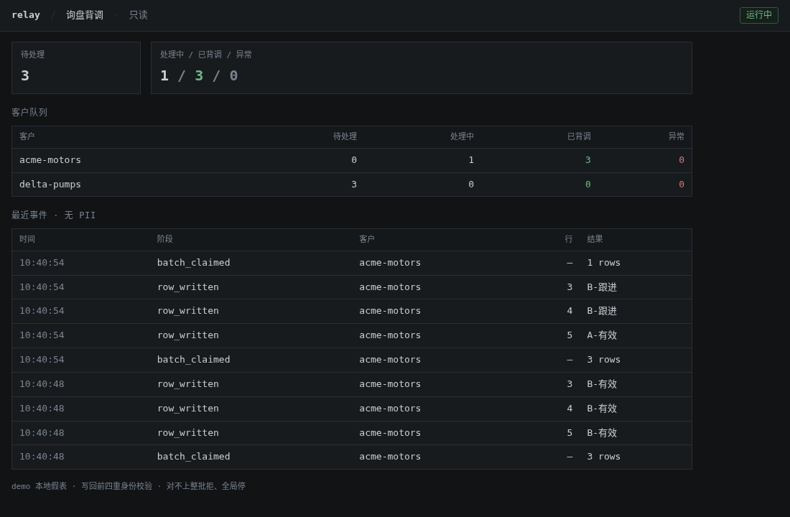

# lead-verification-relay-demo

Local demo of a lead-verification relay. It claims a batch of inquiries for one fictional customer, checks identity before writing results back, and pauses for a person when the check fails. The public tree has no customer data, credentials, or real contact details.

询盘按客户成批领取，背调结果写回原行。写回前核对客户、任务、行号和源行指纹。任一不一致，本批不写入，相关行标为异常，服务进入暂停，等人工看过再恢复。

这是生产流程的公开演示：校验、暂停和列白名单还在。Google Sheets 与网页分析换成内存假表和调用方提交的结果。

## 它做什么

1. `POST /api/batches/claim` 领取当前队列里第一个客户最早的若干行，标成「处理中」，并为每行签发指纹。
2. 调用方把分析放进 `POST /api/batches/{job_id}/writeback`。
3. 服务核对客户、任务、行号、调用方带回的指纹，并按表里**当前**内容重算指纹。
4. 通过则只写白名单列。身份不一致则整批不写，行变为「背调异常」，服务暂停，该批次关闭。
5. 浏览器打开 `/` 看只读工作台。`/healthz` 看进程和心跳。交互式接口说明在 `/docs`。

种子行使用虚构客户编号 `acme-motors` 和 `delta-pumps`，没有姓名、邮箱或电话。进程退出后内存表消失。

## 架构

```text
调用方  demo_flow / curl
        |  claim、writeback、resume
        v
FastAPI  src/relay_demo/app.py
        |-- verify.py   指纹与四重身份校验
        |-- store.py    FakeSheetStore，模拟表格的领取和列边界
        |-- events.py   有界 JSONL，字段白名单，按字节轮转
        |-- config.py   RELAY_* 环境变量
        v
只读工作台  GET /
```

生产环境的表是 Google Sheets，分析来自受控的网页会话，暂停状态需要跨重启保留。这里全部在一个进程里，方便把拒绝和暂停跑通。

```text
src/relay_demo/
  app.py  config.py  demo_flow.py  events.py  models.py  store.py  verify.py
tests/
```

## 快速开始

需要 Python 3.11 或 3.12。

```bash
git clone https://github.com/1-1-1-11/lead-verification-relay-demo.git
cd lead-verification-relay-demo
python -m venv .venv
source .venv/bin/activate          # Windows: .venv\Scripts\activate
pip install -e ".[dev]"
cp .env.example .env               # 可选；不复制也能用默认值
pytest -q
python -m relay_demo               # http://127.0.0.1:8017/
```

另开一个终端，激活同一个虚拟环境：

```bash
python -m relay_demo.demo_flow
python -m relay_demo.demo_flow --tamper
curl -s -X POST http://127.0.0.1:8017/api/ops/resume
```

`demo_flow` 请求 `RELAY_BASE_URL`（默认 `http://127.0.0.1:8017`），不会自己造一份内存数据。请先启动服务。

也可以不安装成可编辑包：

```bash
pip install -r requirements-dev.txt
PYTHONPATH=src pytest -q
PYTHONPATH=src python -m relay_demo
```



## 环境变量

启动时读取当前目录的 `.env`，不覆盖已经导出的环境变量。完整列表和说明见 [`.env.example`](.env.example)。

| 变量 | 默认 | 作用 |
|---|---|---|
| `RELAY_HOST` | `127.0.0.1` | `python -m relay_demo` 的监听地址 |
| `RELAY_PORT` | `8017` | 监听端口 |
| `RELAY_DATA_DIR` | `./data` | 事件日志目录 |
| `RELAY_DEFAULT_BATCH_SIZE` | `3` | 省略 `batch_size` 时的领取条数 |
| `RELAY_MAX_BATCH_SIZE` | `5` | 单次领取上限，超出返回 422 |
| `RELAY_EVENT_LOG_MAX_BYTES` | `2097152` | 日志按 UTF-8 字节轮转 |
| `RELAY_EVENT_LOG_BACKUPS` | `3` | 保留的轮转文件数 |
| `RELAY_MONITOR_MAX_LAG_SECONDS` | `15` | 心跳更旧则拒绝领取（503） |
| `RELAY_BASE_URL` | `http://127.0.0.1:8017` | `demo_flow` 的目标地址 |

`RELAY_HOST` 和 `RELAY_PORT` 只作用于 `python -m relay_demo`。直接用 `uvicorn relay_demo.app:app --host ... --port ...` 时，监听地址以命令行为准，其余 `RELAY_*` 仍然生效。

换端口：

```bash
RELAY_PORT=8020 python -m relay_demo
RELAY_BASE_URL=http://127.0.0.1:8020 python -m relay_demo.demo_flow
```

`.env` 已被忽略。不要把真实令牌或表格 ID 写进示例文件。

## 示例输出

下面是对一次新启动的服务先走正常写回、再篡改指纹。`job_id` 和 `task_id` 每次不同。指纹由种子行算出，内容不变时保持不变。

正常写回（节选；领取成功时脚本会先打印完整 JSON，再打印摘要行）：

```text
目标服务 http://127.0.0.1:8017
== 1. 领取批次 ==
HTTP 200
job_id=<job_id>  customer=acme-motors  rows=[2, 3, 4]

== 2. 提交背调结果 ==
HTTP 200
{'written': 3, 'job_id': '<job_id>'}

== 3. 健康检查 ==
HTTP 200
{'web': 'ok', 'version': '0.1.0', 'monitor': {'alive': True, 'lag_seconds': 0.2}, 'paused': False, 'pause_reason': ''}
```

接着在同一进程上篡改指纹。此时 `acme-motors` 只剩第 5 行：

```text
== 1. 领取批次 ==
HTTP 200
job_id=<job_id>  customer=acme-motors  rows=[5]

== 2. 提交背调结果(含篡改指纹) ==
HTTP 409
{'detail': {'error': 'identity_mismatch', 'mismatches': [{'row_number': 5, 'field': 'fingerprint'}], 'action': '整批未写回,已进入全局人工暂停'}}

== 3. 健康检查 ==
HTTP 200
{'web': 'ok', 'version': '0.1.0', 'monitor': {'alive': True, 'lag_seconds': 0.2}, 'paused': True, 'pause_reason': '批次 <job_id> 身份校验失败,需人工核对'}

== 4. 暂停状态下尝试领取新批次 ==
HTTP 423  全局人工暂停中:批次 <job_id> 身份校验失败,需人工核对

== 5. 人工恢复 ==
HTTP 200
{'resumed': True}
```

恢复只解除暂停。被拒绝的那一批不能再次写回，异常行也不会自动变回待处理。重启进程会回到种子数据。

领取响应的形状：

```json
{
  "job_id": "job id",
  "customer_id": "acme-motors",
  "items": [
    {
      "job_id": "job id",
      "task_id": "task id",
      "customer_id": "acme-motors",
      "row_number": 2,
      "fingerprint": "16 hex chars"
    }
  ]
}
```

## 安全边界

- 指纹是 `sha256` 的前 16 位十六进制。输入是按键排序的 JSON：`customer_id`、`row_number`、`product`、`quantity`、`country`。状态列不参与指纹，所以「处理中」不会造成失配。
- 调用方必须交回领取时的指纹。服务还会按当前行重算。两边任一不同都算身份失败。
- 身份失败：整批不写，全部标为异常，服务暂停，批次关闭。`POST /api/ops/resume` 之后可以领新批次，不能重开旧批次。
- 结果必须和领取到的任务一一对应。缺行或重复返回 409 `incomplete_batch`，不写、不暂停，可以整批重试。
- 可写列只有 `analysis`、`lead_level`、`source_url`、`verified_time`。时间由服务填写。
- `lead_level` 只接受 `A-高潜力`、`B-有效`、`C-待确认`。
- 事件日志只保留 `stage`、`job_id`、`task_id`、`customer_id`、`row_number`、`result`、`detail`。不记分析正文、URL、指纹和联系方式。单字段字符串截断到 200 字。
- 工作台转义动态文本，并设置 `Content-Security-Policy` 和 `Cache-Control: no-store`。
- 默认只监听本机，没有登录。不要把它暴露到公网。

## 开发

见 [CONTRIBUTING.md](CONTRIBUTING.md)。漏洞请按 [SECURITY.md](SECURITY.md) 私下报告。版本记录见 [CHANGELOG.md](CHANGELOG.md)。许可是 MIT。
