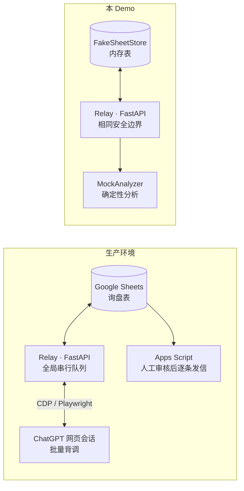

# Lead Verification Relay · Demo

> 多客户询盘背调 Relay:从 Google Sheets 领取询盘 → 批量背调 → **逐行身份校验**后写回 → 人工审核邮件。
> 本仓库是生产系统的**脱敏教学版**:安全边界与生产一致,外部依赖(ChatGPT 网页、Google API)全部替换为本地模拟,不含任何客户数据、提示词与密钥。


---

## 为什么这个项目值得看

这个系统替真人做一件**错了很贵**的事:把背调结果写回业务表格,并触发发给真实客户的邮件。
所以它的核心不是"自动化",而是**在任何不确定的时刻停下来,等人来**:

| 风险 | 设计 |
|---|---|
| 把 A 客户的分析写进 B 客户的行 | 每条结果携带 `customer_id + task_id + 行号 + 源行指纹`,**四重身份逐行校验**,任一不匹配整批拒绝 |
| 发送/网络结果不确定时自动重试 → 重复发信 | **不自动重发**。进入持久的全局人工暂停,明确人工恢复前不再领取任何批次 |
| 自动化失控无人察觉 | `/healthz` 区分 Web 存活与监控线程存活/停滞;健康检查不通过则禁止领取 |
| 日志变成新的泄露面 | 有界 JSONL 事件日志(2 MB × 3 轮转),字段白名单,**不记录提示词、正文、URL、PII** |
| 写回越权 | 写回列白名单:只允许写分析结果相关 4 列,其余列代码层面不可达 |

## 架构



## 快速开始

```bash
git clone https://github.com/1-1-1-11/lead-verification-relay-demo.git
cd lead-verification-relay-demo

python -m venv .venv && source .venv/bin/activate   # Windows: .venv\Scripts\activate
pip install -r requirements.txt

# 跑测试:身份校验、全局暂停、写回白名单全覆盖
pytest -q

# 启动本地服务与只读监控台
uvicorn relay_demo.app:app --port 8017
# 打开 http://127.0.0.1:8017/
```

### 手动体验一次完整批次

```bash
# 1. 领取一个批次(同一客户,最多 3 条,标记「处理中」)
curl -X POST "http://127.0.0.1:8017/api/batches/claim?batch_size=3"

# 2. 提交背调结果(演示脚本会用返回的指纹构造合法结果)
python -m relay_demo.demo_flow

# 3. 观察全局暂停:提交一个指纹被篡改的结果 → 409,整批拒绝,服务进入人工暂停
python -m relay_demo.demo_flow --tamper

# 4. 人工恢复
curl -X POST http://127.0.0.1:8017/api/ops/resume
```

## 关键设计:四重身份校验

批次中每一行在领取时生成 `fingerprint = sha256(customer_id | 行号 | 源行内容)`。
写回时,每条结果必须同时通过:

```python
def verify_identity(claimed: ClaimedItem, result: AnalysisResult) -> None:
    if result.customer_id != claimed.customer_id:   raise IdentityMismatch("customer")
    if result.task_id != claimed.task_id:           raise IdentityMismatch("task")
    if result.row_number != claimed.row_number:     raise IdentityMismatch("row")
    if result.fingerprint != claimed.fingerprint:   raise IdentityMismatch("fingerprint")
```

任何一条不匹配:**整批不写回、整批标记异常、服务进入全局人工暂停**。
宁可让业务停下来等人,也不让一行数据写错位置。

## 目录结构

```text
src/relay_demo/
├── models.py    # LeadRow / ClaimedItem / AnalysisResult(Pydantic)
├── store.py     # FakeSheetStore:内存表,模拟 Google Sheets 读写边界
├── verify.py    # 指纹计算 + 四重身份校验
├── events.py    # 有界 JSONL 事件日志:轮转 + 字段白名单(无 PII)
├── app.py       # FastAPI:/healthz、领取、写回、暂停/恢复、只读监控台
└── demo_flow.py # 演示脚本:完整批次 / 指纹篡改攻击演示
tests/
└── test_relay.py
```

## 与生产版本的差异

| 维度 | 生产版本(实习期间开发) | 本 Demo |
|---|---|---|
| 分析引擎 | Playwright + CDP 驱动真实 ChatGPT 网页会话,批量 XLSX 上传 | MockAnalyzer 确定性分析 |
| 数据源 | Google Sheets API(服务账号) | 内存 FakeSheetStore |
| 交付形态 | PyInstaller 打包 Windows 桌面 App,GitHub Actions 私有 Release | 本地 uvicorn |
| 测试规模 | 436 个 pytest 用例,TDD 红→绿流程 | 核心安全路径用例 |
| 数据 | 真实询盘(多语言、多国家) | 虚构演示数据 |

## 截图

见 [`assets/`](assets/)——生产环境监控台与事件日志截图(已脱敏)。

---

*Demo code is a public rewrite of safety patterns from a production system; no client data, prompts, or credentials included.*
